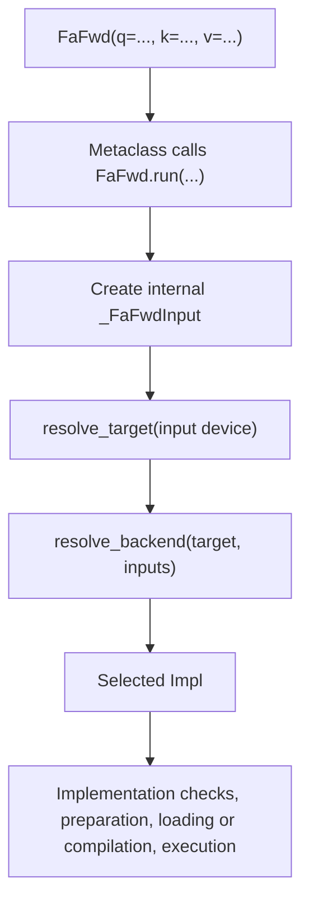

# MATE Operator Design and Development

[中文对照](README_cn.md)

An Op defines what an operator computes. Its Impls provide different algorithms
and kernel implementations. Users call the Op class directly: `FaFwd(...)`.
FA3 and a future FA4 implementation belong to the same attention forward Op,
`FaFwd`.

This guide describes how to develop and migrate operators. The shared `Op` and
`Impl` base classes exist. Attention forward still uses `mate/mha_interface.py`
and `mate/jit/attention/fmha/`; the `FaFwd` class and `fa_fwd` package shown below
are planned migration examples. FA4 has not been integrated into this Op.
Shared AOT, trace, profiling, and build artifact APIs are still being designed.

## Calling an Op

After migration, users will call attention forward as follows:

```python
import mate

# Initialize q, k, and v.
outputs = mate.ops.attention.FaFwd(q=q, k=k, v=v, causal=True)
```

`FaFwd` is an Op class. Its metaclass forwards `FaFwd(...)` directly to
`FaFwd.run(...)`, returning the computation result without constructing an Op
instance or calling `__new__` / `__init__`. Calling an abstract Op raises
`TypeError`. Users pass tensors and ordinary arguments; they do not construct
internal input objects.

Declare the complete public signature, defaults, and type annotations on the
`run` class method. Document the operation on the class and parameters on `run`,
using `Parameters:`, `Returns:`, `Raises:`, and `Examples:` where useful.
IDEs and static type checkers may not show the parameters for `FaFwd(...)`
because the metaclass accepts `*args, **kwargs`. The full signature is on `run`.
Existing API adapters can call `FaFwd.run(...)` to retain argument and return
type checking. Both forms use the same execution path.

Developers import the base interfaces from `mate.ops`:

```python
from mate.ops import Impl, Op
```

| Object | Responsibility |
| --- | --- |
| Concrete Op, such as `FaFwd(Op)` | Define the computation, results, and any changes to caller tensors; determine the target architecture, select an Impl, and provide `run` and `build`. |
| Internal input, such as `_FaFwdInput` | Carry one call's arguments through selection, preparation, and execution. |
| Concrete Impl | Validate and normalize supported inputs, choose configurations, prepare artifacts, and execute one or more kernels. |
| Kernel | Perform one computation within an implementation. |

`FaFwd.run(...)` puts the arguments into a new internal input object, selects
an Impl, and calls it. Impl instances hold reusable resources such as compiled
modules and caches.

## One Op, multiple implementations

Use the same Op for implementations that compute the same operation. FA3 and
a future FA4 implementation belong to `FaFwd`. Forward and backward use separate
Ops, each with its own inputs, outputs, and implementation selection.

Implementations of one Op share the meaning of parameters, default behavior,
return structure, output values such as LSE, rules for modifying caller tensors,
and rules for sharing tensor storage.
They may support different dtypes, dimensions, layouts, or optional features.
Document each implementation's supported subset and reject unsupported requests;
do not ignore arguments or change their meaning when selecting another Impl.
Compare each Impl with the Op's reference result using suitable tolerances.
Floating-point results need not match bit for bit.

Two algorithm versions may both use MUTLASS, and one Impl may share code across
MP31 and MP32. Each Op defines which Impls it supports and how to choose among
them. The base classes leave selection rules, registration, Impl construction,
and caching to each operator.

## Code layout

The planned layout for attention forward is:

```text
mate/
├── arch.py
├── ops/
│   ├── __init__.py
│   ├── op.py
│   ├── impl.py
│   ├── README.md
│   ├── README_cn.md
│   └── attention/
│       ├── __init__.py          # Export the public FaFwd class.
│       └── fa_fwd/
│           ├── __init__.py      # Re-export the public FaFwd class.
│           ├── _input.py        # Internal _FaFwdInput.
│           ├── op.py            # Public FaFwd(Op).
│           └── impls/
│               ├── utils.py
│               └── fa3_mutlass/
│                   ├── __init__.py
│                   ├── impl.py
│                   ├── fwd.py
│                   ├── combine.py
│                   ├── metadata.py
│                   └── utils.py
└── mha_interface.py
```

Add another implementation directory when a real FA4 implementation is available.
Give each separate implementation its own directory. An Impl can share code
across compilers, kernel languages, or target architectures. Reuse the common [Arch](../arch.py).

| Location | Contents |
| --- | --- |
| `ops/op.py`, `ops/impl.py` | Shared base classes and target architecture lookup. |
| `ops/<family>/__init__.py` | Public Op class exports for that family. |
| `ops/<family>/<op>/__init__.py` | Public Op class exports. |
| `ops/<family>/<op>/_input.py` | Private `_XxxInput` structures, excluded from public exports. |
| `ops/<family>/<op>/op.py` | Concrete Op, support information, selection, public `run(...)`, and building. |
| `ops/<family>/<op>/impls/<impl>/` | Implementation-specific checks, configuration, source generation, compilation, and launches. |
| Internal stage modules | Components with distinct preparation or execution responsibilities; split them when useful. |
| `impls/utils.py` | Helpers actually shared by this operator's implementations. |
| Existing interface modules | Existing API signatures and argument adaptation, delegating to the same Op. |

Set up package exports so users can write `import mate` followed by
`mate.ops.attention.FaFwd(...)`, without requiring an additional submodule import.
Follow the repository's import conventions, keep imports at module scope, and
avoid device initialization or compilation as an import side effect.

C++ kernels and headers retain their existing `csrc/` and `include/` locations;
source templates remain under `csrc/templates/`. Shared compilation, loading,
and caching remain reusable from `mate.jit`; operator-specific logic belongs to
the Impl.

## Internal inputs and reusable state

The Op's `run` class method creates a new mutable `_FaFwdInput` for each call,
usually a dataclass in `_input.py`. Distinguish computation parameters from
tuning options and data prepared for a particular Impl. Check which FA3 fields
belong in the shared FA interface before moving them.

For example, q/k/v and causal behavior describe the computation. Split controls,
packing options, scheduler metadata, and returned accumulators need individual
review to decide which Impls support them. Preserve existing API behavior
during migration. Agree on any public API changes separately.

Each Impl owns its dtype, stride, and layout checks in `sanitize(inputs)`.
It returns `None` and may replace fields, for example
`inputs.q = inputs.q.contiguous()` when the implementation permits this copy.
Later configuration and execution consume the updated fields. Replacing a field
does not itself change the caller's tensor; writing through a tensor can change
the caller's data and must follow the Op's documented rules.

An Impl may be reused or created on demand. It can retain a target, compiled
modules, and caches, but should not retain one call's inputs or temporary buffers
as shared state. Cache keys must include the Impl, target architecture, and all input properties
and compiler options that affect the compiled code.

## Selection and execution



This simplified example shows how `run` selects and calls an Impl. The full
method must declare all supported parameters:

```python
import torch

from mate.ops import Op

from ._input import _FaFwdInput


class FaFwd(Op):
    @classmethod
    def run(
        cls,
        *,
        q: torch.Tensor,
        k: torch.Tensor,
        v: torch.Tensor,
        causal: bool = False,
        override_backend: str | None = None,
    ):
        inputs = _FaFwdInput(q=q, k=k, v=v, causal=causal)
        target = cls.resolve_target(device=inputs.q.device)
        impl = cls.resolve_backend(target, inputs, override_backend=override_backend)
        return impl(inputs)
```

Other required class methods are omitted. The Impl executes through `__call__`.
Pass the same internal input object between stages.

`resolve_target` uses the relevant input device, or an explicit compute
capability such as `31` where that entry point supports one.
`resolve_backend` returns an Impl instance and clearly distinguishes algorithm
versions where multiple implementations are available:

- Automatic selection uses target, input features, and documented priority.
- Preserve `override_backend: str | None = None`. A concrete implementation
  identifier must be unambiguous; `fa3_mutlass` is an illustrative identifier,
  not an already supported selector. If a backend name can select multiple Impls,
  document that distinction and the rule for choosing among them.
- Explicit implementation selection reports unsupported requests instead of
  silently substituting another implementation.
- Selection may inspect input properties, but does not normalize tensors, call
  `sanitize`, compile, launch, or trial-run candidates. Each Impl retains its
  complete checks. Do not implement fallback by swallowing validation errors.

The selected Impl arranges validation, preparation, and launches, including
compilation on demand. Normal execution needs no caller-side `sanitize` or
`build` call. Building and execution can share configuration and loading helpers
without execution calling the `build()` method itself.

## Preparing data and combining stages

The FA3 MUTLASS migration composes forward, combine, and metadata components.
Each owns its checks, configuration, and building. Forward returns intermediate
buffers, combine uses them when needed, and the complete Impl assembles the
Op's result. This is an FA3 implementation example, not a required layout for
every Op or future FA4 implementation. Internal components need no separate
public Op.

Scheduler metadata is prepared explicitly when the API requires it; the complete
FA3 forward does not generate it implicitly during execution.

Metadata prepared by one Impl may not work with another. Select an Impl that
supports that metadata and its configuration and layout, or report an error.
Define compatibility rules before reusing or rebuilding metadata for another
Impl. The existing FA3 metadata and combine APIs use FA3-specific arguments and
buffers. Public helpers accept ordinary arguments; input objects stay internal.

## Building and execution

`build(inputs)` prepares the selected implementation's artifacts for the given
internal inputs without launching operation kernels. The Op owns implementation
selection; the Impl owns configuration, compilation, loading, and caches. Reuse
existing build helpers where appropriate; a common `JitSpec` format is not
required by the base interfaces.

Ordinary users call the Op class without building first. Normal execution
loads existing artifacts or compiles on demand as supported by that Impl.
`FaFwd.run(...)` uses the same public arguments as `FaFwd(...)`;
`FaFwd.build(inputs)` is a developer interface using internal inputs.
The base classes also expose an `aot` build parameter for existing AOT paths.
Preserve those paths where supported; that parameter does not require every
Impl to support AOT or define a shared AOT API.

When a concrete implementation uses dry-run execution to prepare a build,
suppress every operation kernel launch and keep fake buffers and build-only
field replacements local. A shallow input copy does not isolate in-place tensor
writes. Detachment or fake conversion used for building must not affect normal
execution or its autograd behavior.

## APIs still being designed

Shared APIs for AOT, trace and replay, profiling, and build artifact management
are still being designed. Operator migrations do not need to implement them.
Preserve existing Impl-specific AOT paths and JIT dump tools.

## Correctness and performance validation

Correctness checks compare each supported Impl against the Op's shared reference
and documented outputs and tensor changes. Use suitable tolerances and valid
element ranges. Cover explicit selection, unsupported combinations, non-contiguous inputs,
optional outputs, and externally visible writes where applicable. A second Impl
must also be checked against the shared reference and documented behavior.

Benchmark the complete Op on equivalent requests and input state, after required
building and warmup. Include internal preparation and necessary combine stages;
report explicitly prepared metadata separately. Restore mutable inputs between
iterations. State which target ran and which target was only compiled.

## Developing and migrating operators

Before adding an Op, check whether an existing Op already computes the requested
operation. Add an Impl when only the algorithm, backend, or target changes.
Create a separate Op when the computation, output meaning, or rules for modifying
caller tensors differ.

Define the public Op class, outputs, internal `_XxxInput`, `run(...)` class
method, selection rules, and Impls. Set up package exports and document the class
and `run` parameters. Keep implementation details in `impls/` and split stages
when they have separate tasks or can be reused.

For an existing operator, preserve API signatures, defaults, result ordering,
tensor preparation, device/stream behavior, and kernel configuration while moving
its implementation. Existing API modules can adapt arguments
and call the same Op. A migration is complete when the Impl owns the operator's
input preparation, building, and kernel calls, and callers use the new code.
Limit changes to the requested operator and direction.

Use relevant existing numerical and interface tests, verify existing build and
loading behavior, and update incremental-test ownership in `tests/main.py` when
paths move. Verify `import mate` followed by the public call without separate
submodule imports.
Development requirements are maintained in [AGENTS.md](../../AGENTS.md).
