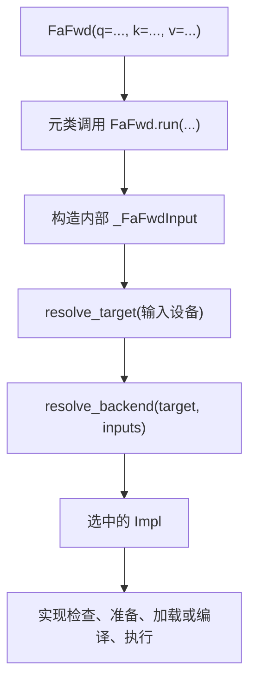

# MATE 算子设计与开发

[English](README.md)

Op 定义算子做什么计算，Impl 提供不同算法和 kernel 实现。用户直接调用 Op 类：
`FaFwd(...)`。FA3 和未来的 FA4 都属于 attention 前向算子 `FaFwd` 的实现。

本文说明如何开发和迁移算子。当前已有 `Op` 和 `Impl` 基类。attention 前向仍使用
`mate/mha_interface.py` 和 `mate/jit/attention/fmha/`；下文的 `FaFwd` 类和
`fa_fwd` 目录是迁移后的设计示例。FA4 尚未接入这个 Op。AOT、trace、profiling 和
编译产物管理的通用接口仍在设计中。

## 调用 Op

迁移后，用户这样调用 attention 前向：

```python
import mate

# 初始化 q、k、v。
outputs = mate.ops.attention.FaFwd(q=q, k=k, v=v, causal=True)
```

`FaFwd` 是 Op 类。元类将 `FaFwd(...)` 直接转发到 `FaFwd.run(...)`，
返回计算结果，不创建 Op 实例，也不调用 `__new__` 或 `__init__`。
调用抽象 Op 会抛出 `TypeError`。用户传入 tensor 和普通参数，无需构造内部输入对象。

`run` 类方法显式声明完整公开签名、默认值和类型提示。类上说明算子做什么计算，
`run` 上说明参数，按需使用 `Parameters:`、`Returns:`、`Raises:` 和 `Examples:`。
元类通过 `*args, **kwargs` 转发参数，因此 IDE 和静态类型检查器可能无法显示
`FaFwd(...)` 的完整参数列表。完整签名定义在 `run` 上。
现有 API 适配层可以调用 `FaFwd.run(...)`，保留参数和返回值的类型检查。
两种写法走同一条执行路径。

开发者从 `mate.ops` 导入基础接口：

```python
from mate.ops import Impl, Op
```

| 对象 | 职责 |
| --- | --- |
| 具体 Op，例如 `FaFwd(Op)` | 定义计算、结果和对调用者 tensor 的修改规则；确定目标架构、选择 Impl，提供 `run` 和 `build`。 |
| 内部输入，例如 `_FaFwdInput` | 在选择、准备、执行之间传递一次调用的参数。 |
| 具体 Impl | 检查与整理所支持的输入，选择配置、准备产物、执行一个或多个 kernel。 |
| Kernel | 完成实现中的一次计算。 |

`FaFwd.run(...)` 将参数放入新的内部输入对象，选择 Impl 并调用它。
编译模块、缓存等可复用资源由 Impl 实例保存。

## 一个 Op，多种实现

完成同一种计算的实现使用同一个 Op。FA3 和未来的 FA4 实现都归入 `FaFwd`。
前向和反向使用独立的 Op，各自定义输入、输出和实现选择规则。

同一 Op 的各 Impl 遵守相同的参数含义、默认行为、返回结构、LSE 等输出定义，
以及对调用者 tensor 的修改规则和共享存储规则。各 Impl 可以支持不同的 dtype、维度、布局或
可选功能。明确记录各自支持的范围，拒绝不支持的请求；不能因为切换实现就忽略
参数或改变参数含义。各 Impl 都与共同的参考结果比较，使用合适的容差，
无需让浮点结果逐位一致。

两个算法版本都可能使用 MUTLASS，同一个 Impl 也可以在 MP31、MP32 之间共享
代码。各 Op 定义支持哪些 Impl、如何选择。选择规则、注册方式、Impl 创建方式
和缓存方式由各算子决定。

## 代码目录

attention 前向计划使用以下目录：

```text
mate/
├── arch.py
├── ops/
│   ├── __init__.py
│   ├── op.py
│   ├── impl.py
│   ├── README.md
│   ├── README_cn.md
│   └── attention/
│       ├── __init__.py          # 导出公开类 FaFwd。
│       └── fa_fwd/
│           ├── __init__.py      # 重新导出公开类 FaFwd。
│           ├── _input.py        # 内部 _FaFwdInput。
│           ├── op.py            # 公开 FaFwd(Op)。
│           └── impls/
│               ├── utils.py
│               └── fa3_mutlass/
│                   ├── __init__.py
│                   ├── impl.py
│                   ├── fwd.py
│                   ├── combine.py
│                   ├── metadata.py
│                   └── utils.py
└── mha_interface.py
```

有 FA4 实现时再增加对应目录。每个独立实现使用自己的目录。一个 Impl 可以在
不同编译器、kernel 语言或目标架构之间共享代码。架构信息使用共享的 [Arch](../arch.py)。

| 位置 | 内容 |
| --- | --- |
| `ops/op.py`、`ops/impl.py` | 共享基类与目标架构查询。 |
| `ops/<family>/__init__.py` | 该类别的公开 Op 类导出。 |
| `ops/<family>/<op>/__init__.py` | 公开 Op 类导出。 |
| `ops/<family>/<op>/_input.py` | 内部 `_XxxInput` 结构，不从公开入口导出。 |
| `ops/<family>/<op>/op.py` | 具体 Op、支持信息、选择规则、公开 `run(...)` 和构建。 |
| `ops/<family>/<op>/impls/<impl>/` | 实现相关的检查、配置、源码生成、编译与 kernel 调用。 |
| 内部阶段模块 | 有独立准备或执行职责的组件，按实际需要拆分。 |
| `impls/utils.py` | 该算子的多个实现之间实际共享的辅助逻辑。 |
| 现有接口模块 | 保留已有 API 签名并适配参数，委托给同一个 Op。 |

设置好包的导出，让用户只需 `import mate`，随后就能调用 `mate.ops.attention.FaFwd(...)`，
无需额外导入子模块。遵循仓库的导入方式，Python import 放在模块顶层，导入时不
初始化设备或触发编译。

C++ kernel 和头文件沿用已有的 `csrc/`、`include/` 位置；源码模板保留在
`csrc/templates/` 中。`mate.jit` 中共享的编译、加载、缓存机制可以复用，算子
专属逻辑归入对应 Impl。

## 内部输入与可复用状态

Op 的 `run` 类方法为每次调用创建新的可变 `_FaFwdInput`，通常是 `_input.py`
中的 dataclass。区分计算参数、调优选项和为特定 Impl 准备的数据。迁移 FA3 字段
前，先检查哪些适合放进通用 FA 接口。

例如，q/k/v 和 causal 行为描述计算本身；split 控制、packing 选项、scheduler
metadata 和返回累加缓冲，需要分别确认哪些 Impl 支持。迁移时保留现有 API
行为，公开 API 的改动另行讨论。

各 Impl 在自己的 `sanitize(inputs)` 中检查 dtype、stride、layout 等约束。
该方法返回 `None`，可以替换字段，例如在实现允许复制时执行
`inputs.q = inputs.q.contiguous()`。后续配置和执行必须使用更新后的字段。
替换字段本身不改变调用者的 tensor；原地写入可能改变调用者的数据，必须符合
Op 文档中的修改规则。

Impl 实例可以复用，也可以按需创建。实例可以保存 target、编译模块和缓存，但
不应把某次调用的输入或临时缓冲保存为共享状态。缓存 key 必须包含 Impl、目标架构，
以及所有影响编译结果的输入属性和编译选项。

## 选择与执行



下面的简化示例展示 `run` 如何选择并调用 Impl。完整方法必须列出全部支持参数：

```python
import torch

from mate.ops import Op

from ._input import _FaFwdInput


class FaFwd(Op):
    @classmethod
    def run(
        cls,
        *,
        q: torch.Tensor,
        k: torch.Tensor,
        v: torch.Tensor,
        causal: bool = False,
        override_backend: str | None = None,
    ):
        inputs = _FaFwdInput(q=q, k=k, v=v, causal=causal)
        target = cls.resolve_target(device=inputs.q.device)
        impl = cls.resolve_backend(target, inputs, override_backend=override_backend)
        return impl(inputs)
```

示例省略其他必需的类方法。Impl 通过 `__call__` 执行。各阶段传递同一个内部输入对象。

`resolve_target` 使用相关输入所在的设备；入口支持显式指定计算能力时，也可以
使用 `31` 等计算能力值。
`resolve_backend` 返回 Impl 实例，在存在多个实现时明确区分算法版本：

- 自动选择根据 target、输入特征和已说明的优先级进行。
- 保留 `override_backend: str | None = None`。具体实现标识必须无歧义；
  `fa3_mutlass` 仅作为标识示例，不表示当前已支持该选择值。如果某个 backend
  名称可对应多个 Impl，文档必须说明这种区别和具体选择规则。
- 显式指定实现时，不支持的请求应报告原因，不能静默替换为另一实现。
- 选择过程可以读取输入属性，但不整理 tensor、不调用 `sanitize`、不编译、
  不执行或试跑候选。各 Impl 保留完整检查，不通过吞掉检查错误实现 fallback。

选中 Impl 自行组织检查、准备与执行，包括按需编译。正常调用无需调用者先执行
`sanitize` 或 `build`。构建与执行可以复用配置和加载 helper，不要求执行时调用
`build()` 方法本身。

## 准备数据与组合阶段

FA3 MUTLASS 的迁移方案组合 forward、combine 和 metadata 组件，各自管理检查、
配置与构建。Forward 返回中间缓冲，combine 在需要时使用这些缓冲，完整 Impl 整理
Op 的返回结果。这是 FA3 的实现案例，不是每个 Op 或未来 FA4 的固定目录模板。
内部组件无需各自建立公开 Op。

API 要求显式准备 scheduler metadata 时，由 metadata 组件完成；完整 FA3 前向
执行时不隐式生成 metadata。

某个 Impl 准备的 metadata 可能不适用于另一个 Impl。执行时应选择支持该
metadata 及其配置、布局的 Impl，否则报错。在其他 Impl 中复用或重新生成
metadata 前，先定义兼容规则。现有 FA3 metadata 和 combine 接口使用 FA3 专用的
参数和缓冲。公开辅助函数接收普通参数，输入对象只在内部使用。

## 构建与执行

`build(inputs)` 使用内部输入，准备所选实现需要的产物，不执行算子的 kernel。
Op 选择 Impl，Impl 负责配置、编译、加载与缓存。按需复用已有构建 helper；
基础接口不要求使用通用的 `JitSpec` 格式。

普通用户直接调用 Op 类，无需提前构建。正常执行按该 Impl 支持的方式加载已有
产物或按需编译。`FaFwd.run(...)` 与 `FaFwd(...)` 使用相同的公开参数；
`FaFwd.build(inputs)` 是使用内部输入的开发者接口。
基类还为已有 AOT 路径提供 `aot` 构建参数。支持这些路径时应予以保留；
这个参数不要求每个 Impl 支持 AOT，也不代表已有通用 AOT 接口。

具体实现通过 dry-run 准备构建时，必须跳过全部算子 kernel，并将 fake 缓冲和
构建专用字段替换限制在本次构建内。输入的浅拷贝不能隔离 tensor 原地写入。
构建中的 detach 或 fake 转换不得影响正常执行及其 autograd 行为。

## 仍在设计的接口

AOT、trace 与重放、profiling 和编译产物管理的通用接口仍在设计中，算子迁移
无需实现这些接口。保留已有 Impl 专用的 AOT 路径和 JIT dump 工具。

## 正确性与性能验证

正确性检查依据 Op 的共同参考结果、输出定义和 tensor 修改规则，使用合适的容差与
有效元素范围。覆盖显式实现选择、不支持的组合、非连续输入、可选输出，以及适用
场景中对调用者 tensor 的写入。新增第二个 Impl 时，同样检查共同参考结果和
文档规定的行为。

Benchmark 在等价的请求与输入状态上测试完整 Op，先完成所需构建与预热。
计时包含内部准备和必要的 combine 阶段，显式准备的 metadata 开销单独报告。
每轮恢复可变输入，说明哪些 target 实际运行、哪些只做了编译验证。

## 新增与迁移算子

新增 Op 前，先检查已有 Op 是否已经完成所需计算。只有算法、后端或目标架构
改变时，向已有 Op 添加 Impl。计算、输出含义或对调用者 tensor 的修改规则不同
时，再定义独立 Op。

定义公开 Op 类、输出、内部 `_XxxInput`、`run(...)` 类方法、选择规则和 Impl。
设置好包的导出，在类和 `run` 上说明用法和参数。实现细节放在 `impls/` 内；
需要独立完成某项工作或复用代码时，再拆分阶段。

迁移现有算子时，保留 API 签名、默认值、结果顺序、tensor 准备、设备与 stream
行为，以及 kernel 配置。现有 API 模块可以适配参数并调用同一个 Op。
当 Impl 负责算子的输入准备、构建和 kernel 调用，且调用方都使用新代码时，迁移
才算完成。修改范围限于请求的算子和前向或反向。

使用相关的已有数值与接口测试，验证现有构建与加载行为；移动路径时更新 `tests/main.py`
的增量测试归属。验证只执行 `import mate` 后即可调用公开 Op 类，无需额外导入
子模块。开发要求维护在 [AGENTS.md](../../AGENTS.md) 中。
